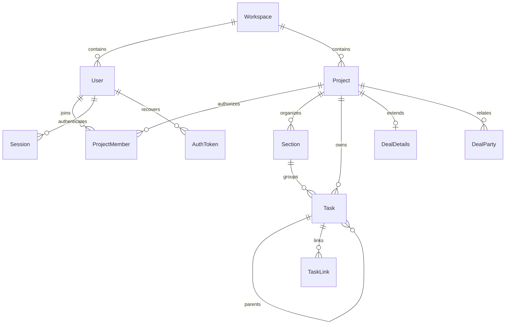

# SHO data contract

Source of truth: `prisma/schema.prisma` plus the complete ordered SQL migration history. Prisma alone does not describe partial indexes, triggers or every check constraint. `MODEL-REFERENCE.md` is a generated field/relation inventory; regenerate with `node scripts/data-reference.mjs`. Migration identity and the already-applied nullable deadline expansion are documented in `../runbooks/schema-releases.md`.

## Ownership and relationships

SHO is one organisation per deployment, per the owner decision in HR-11; see ../runbooks/workspace-contract.md. Multiple workspace rows are an invalid runtime state, not supported tenant isolation. Project membership and organisation role enforce application access. An application role with DML access is not PostgreSQL row-level security. Keep database administration credentials separate from runtime credentials.

## Invariants beyond Prisma

Ordinary task editing (`updateTask`) performs a cheap permission/version preflight, then locks the task row and the actor's project membership before re-reading authorization and version inside a ReadCommitted transaction. A completed removal yields the same task404 as an unknown task; a completed Viewer downgrade yields403. An edit already holding the membership lock commits before a competing removal. The task write, before/after audit and related notices commit together. The stored edit version advances by at least one millisecond, so two saves of the same version cannot both succeed. Membership release hands over tasks before deleting/updating the membership; preserve that task-before-membership lock order. Because Leader replacement can hold membership first, the edit takes its membership lock with NOWAIT and returns a retryable409 if another writer owns it; it does not wait in a reverse lock order. These guarantees are scoped to ordinary editing, not a claim that assignment/move/link/Undo concurrency has been fully reviewed.

- A project's **at most one** Leader is enforced by partial unique index `ProjectMember_one_leader_per_project`; application transactions must maintain **at least one**. These are distinct guarantees.
- `Section_one_done_per_project` allows at most one Done section. Application creation/mutation preserves a usable Done section.
- `Section_max_8` / `enforce_max_sections` cap sections. The function was replaced by the pinned-search-path migration; inspect the latest definition, not just init SQL.
- `Task_section_in_project` / `enforce_task_section_in_project` reject section/project mismatches. Application transactions enforce other assignment, parent, approval and membership rules; foreign keys alone do not establish authorisation.
- `User_email_lowercase` and unique email enforce canonical account identities.
- CRM SQL maintains one Buyer per deal, distinct organisation/contact task links, one-target link checks and revenue/date constraints. See ordered SQL and the generated custom-SQL inventory.
- Vertical project uniqueness is a partial, case-insensitive index scoped by workspace and live status.
- Holy Sheet task movement uses `holy_sheet_task_move`; do not drop this trigger or SuiteGrant/CentralSessionLink while refactoring SHO.
- Bid-stage mapping has guarded before/after invariants and historical stage IDs. Do not rerun its data mapping manually.

A clean Prisma migration replay in CI is necessary but does not prove each negative/concurrent constraint case. Run direct constraint violations and competing mutations in an isolated database before claiming the entire contract verified.

## Deletion, Undo and retention

User deactivation is the normal account operation. Task/project deletion is normally a soft delete, permitting role-checked restoration/Undo. `undoable.ts` defines 30 × 24 hours; exactly the boundary is still eligible. Never substitute physical deletion for an application soft-delete path.

Undo of an ordinary `task.updated` action locks the task, project, actor membership and original action before re-reading permissions, replay state and field conflicts inside one ReadCommitted transaction. Project/membership/action locks use NOWAIT to avoid reverse-order waits with management operations. A newly discovered conflict still requires explicit confirmation. The conditional action claim, inverse write, activity record and any override notices/audit commit or roll back together; a duplicate Undo cannot apply twice. The task version advances monotonically, and an explicit override changes only the recorded fields. Assignment, send-for-approval, send-back and approver-change Undo also use these locked, fresh permission/conflict checks and conditional claim. They restore only the recorded person fields (including paired assignee/approver changes), recheck the previous person’s eligibility and advance task versions monotonically. Project, member and section Undo requires current Leader/Admin management rights. Management Undo repeats the role, archive and replay checks under a project lock before atomically claiming the action and writing its inverse and activity. This protects former Leaders who now have only Editor rights; resource-specific management races remain a separate review boundary. Task creation/deletion/restoration Undo uses the same conditional claim and transaction boundary. Its delete/restore helpers accept an internal transaction, and permissions plus deletion state are re-read there; affected parent/child rows are locked with NOWAIT before applying the inverse. Existing deletion cohorts are restored together, while an older independent deletion remains in Trash. Data, reassignment notices, claim and activity roll back together on failure. Direct delete/restore callers still use their own transactions. This does not establish concurrency safety for every other Undo kind or every concurrent subtask-creation path; CRM and other inverse actions remain separate review work. Concurrent removal/downgrade of a restored assignee or approver, and user deactivation/organisation-role races, remain separate boundaries; checking eligibility inside a transaction alone does not serialize the management handover.

`jobs.ts` defines intended cleanup: tasks/comments older than 30 days in Trash; notifications after 90 days; action/audit history after 12 months. These are code policies, not evidence that any schedule is enabled or has run. Schedules remain paused. Retention changes require an owner decision and data-loss review.

Each relation's `onDelete` policy is listed in the reference. Important examples: user sessions/tokens cascade; ActionLog actor and ModelUsage user restrict deletion; audit actors are set null. Before deleting a row, inspect all inbound relations and external Holy Sheet links, not only the nearest model. Restored data must retain custom constraints and accepted legacy values.

## Sensitive and retired data

Personal data includes names, email addresses, contact details, notes/comments/task text, session user agents, IP/audit metadata and generated mail outboxes. Password hashes, token hashes and central/suite credentials must never appear in logs or evidence. Hashes of auth tokens are not suitable identifiers for public test reports.

Concierge has been removed from the application. `ChatMessage`, `ModelUsage`, Concierge enum values and legacy user preference fields are retained storage under the no-DROP policy. Do not restore those features or delete their data as incidental cleanup. Classify retention/export requirements before any future removal. Native suite routes and Holy Sheet link records are active integrations, not Concierge leftovers.

## Acceptance still required

A new maintainer should replay history in a disposable DB, inspect triggers/indexes/checks, execute role and inverse-operation fixtures, and compare a restored backup with this contract. Production catalog parity and a real restore drill remain open audit gates. This document authorizes no DDL or production operation.
